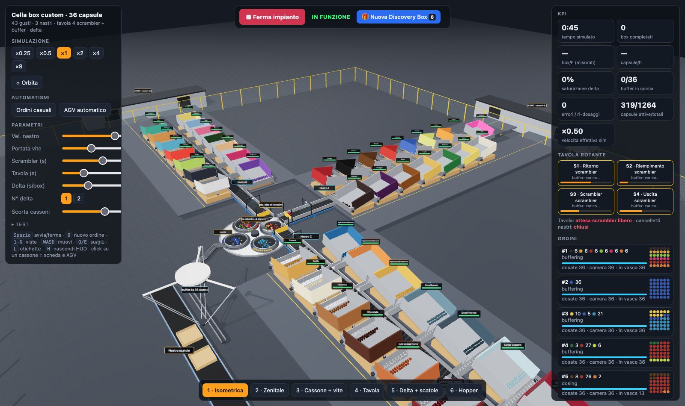
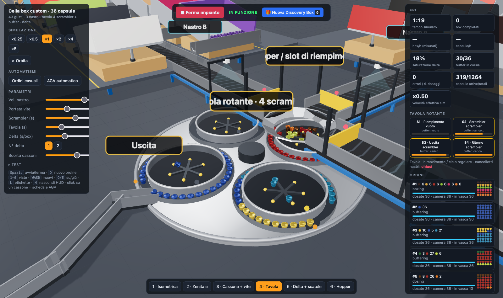
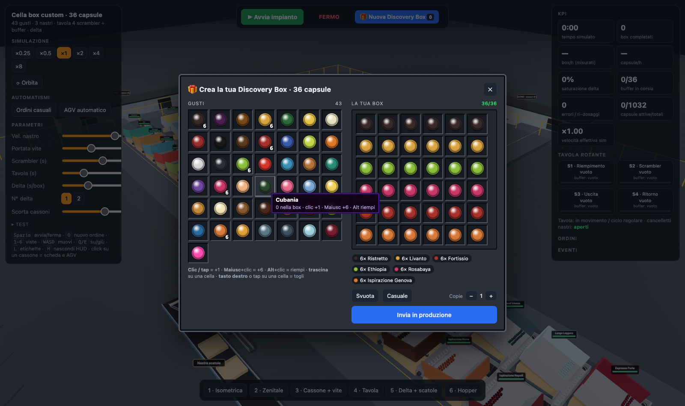
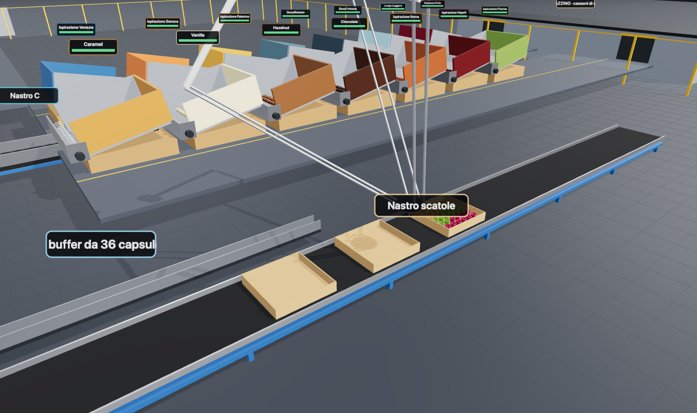

# Cella di confezionamento Discovery Box — simulazione 3D

Simulazione interattiva nel browser di una cella automatica che prepara **Discovery Box personalizzate da 36 capsule**
a partire da 43 gusti, sviluppata come caso di studio per il corso di *Systems Engineering*.
Three.js per la grafica, [Rapier](https://rapier.rs) per la fisica reale delle capsule. Unità: 1 unità = 1 dm.

**Demo online:** https://systemsengineering.centemeri.org



## Come funziona la cella

1. **43 cassoni** (uno per gusto, su tre nastri) sono inclinati verso il lato basso: sempre un po' (12°), sempre di più
   (fino a 28°) man mano che si svuotano, così le capsule scivolano da sole sul fondo, senza scuotimenti che le rovinerebbero.
2. Lungo il lato basso corre una **vite di Archimede**, perpendicolare al nastro: preleva le capsule una alla volta e le
   scarica sul nastro (alimentazione continua).
3. I **nastri** portano le capsule dell'ordine all'hopper. Alla fine di ogni nastro un **cancelletto** trattiene le capsule
   degli ordini successivi finché sotto l'hopper non c'è uno scrambler libero.
4. La **tavola rotante** ha 4 scrambler (60 s ciascuno) che orientano le capsule. Ogni scrambler ha un **buffer ad anello**:
   le capsule escono dritte, una alla volta durante lo scrambling, e si dispongono in fila.
5. Quando il buffer è pieno la tavola lo porta all'uscita: in **5 s** (rotazione + scarico) le capsule vanno in fila sulla corsia.
6. Un **robot delta** impiega **10 s a scatola** per sistemare le 36 capsule nella disposizione scelta dall'utente.
7. Quando un cassone si svuota si chiama un **AGV**: arriva da un magazzino esterno con un cassone di scorta e lo scambia.



## Uso

- **▶ Avvia impianto** (o barra spaziatrice): l'impianto parte fermo.
- **🎁 Nuova Discovery Box** (tasto `O`): menu a griglia con tutti i gusti a sinistra e la box 6×6 a destra.
  Clic/tap = +1 capsula, Maiusc+clic = +6, Alt+clic = riempi, trascina su una cella, tasto destro o tap su una cella = togli.
  Il nome del gusto compare al passaggio del mouse. "Invia in produzione" accetta anche più copie.
- **Clic su un cassone**: scheda con scorta e inclinazione e pulsante **Chiama AGV**; la camera segue l'AGV.
- Slider per velocità nastro, portata vite, tempo scrambler, tempo tavola, secondi a scatola del delta, scorta cassoni.





Scorciatoie: `1-6` viste · `WASD`/`Q E` muovi · `L` etichette · `H` nascondi HUD.
Parametri URL: `?speed=4` `?hud=0` `?fps=60` `?cam=x,y,z,tx,ty,tz` `?norender` (solo logica, per i test).

## Sviluppo

```sh
npm install
npm run dev      # http://localhost:5173
npm run build
```

Il render è limitato a 30 fps (`?fps=60` per più fluidità) e le ombre sono ricalcolate di rado, per tenere basso il carico
su GPU e CPU. La fisica gira nel browser: il server serve solo file statici.

### Docker

```sh
docker compose up -d --build   # nginx con la build statica, rete docker "proxy"
```

`deploy-to-pi.sh` copia il progetto su un Raspberry Pi e lo avvia dietro Caddy.

## Struttura

| File | Contenuto |
|---|---|
| `src/config.js` | geometrie, costanti, parametri di default |
| `src/core.js` | scena Three.js, fisica Rapier, capsule istanziate |
| `src/plant.js` | nastri, cancelletti, cassoni inclinati con vite, hall e magazzino |
| `src/table.js` | tavola rotante, scrambler e buffer ad anello |
| `src/line.js` | corsia, scatole, robot delta, AGV |
| `src/sim.js` | ordini, controllo tavola, cancelletti, AGV, ciclo di simulazione |
| `src/builder.js` | menu a griglia per comporre la box |
| `src/main.js` | interfaccia, camere, HUD |
